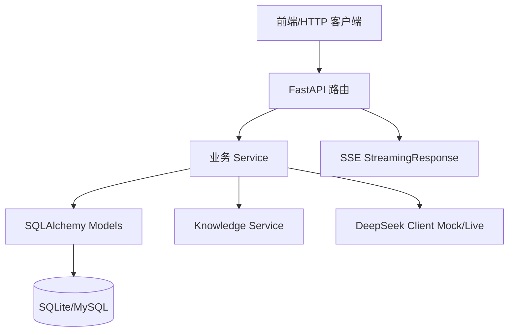

# 架构设计 (Architecture Specification)

> **功能名称：** 按接口文档补全并固化后端接口
> **版本：** v1.0
> **状态：** 已批准
> **关联需求：** `docs/specs/product.md`
> **最后更新：** 2026-09-10

## 1. 系统概览

沿用现有 FastAPI 应用和路由模块。API 层负责请求/响应适配与错误传播，Service 层负责用户聚合、岗位检索、AI 调用和记录持久化，SQLAlchemy 负责 SQLite/MySQL 数据访问，知识库服务负责岗位 Markdown 检索，DeepSeek 客户端负责 live/mock 与 Token 统计。实现只修复接口文档与现状的差异，不改变已公开路径。

### 架构决策记录 (ADR)

| 决策 | 选择方案 | 被否定方案 | 理由 |
|:---|:---|:---|:---|
| API 契约 | 复用现有路由和 Schema，按 V2.1 补行为 | 重命名或新增版本化路径 | 前端已依赖 `/api` 路径 |
| AI 无 Key 行为 | 保留动态 Mock 并标记 `is_mock` | 测试强依赖外部 API | 本地开发必须可重复 |
| 验证存储 | 隔离 SQLite + FastAPI TestClient | 依赖运行中服务或真实数据库 | 降低环境耦合 |

## 2. 组件拓扑图

## 3. 数据模型

沿用现有 `User`、`UserSkill`、`UserProject`、`UserCompetition`、`UserInternship`、`JobMatchRecord`、`ProfileAnalysis`、`ResumeOptimization`、`GrowthPlan` 模型及关系。不得在本次任务中新增字段或迁移；重点确认记录序列化与用户外键关联可用。

## 4. API / 接口签名

接口集合固定为接口文档第 3 至第 8 章列出的 27 个端点：

- 系统：`GET /`、`GET /api/health`、`GET /api/usage`
- 用户：`POST /api/users`，`GET/PUT /api/users/{id}`，四个经历替换端点，`GET /api/users/{id}/context`
- 岗位：`GET /api/jobs`、`GET /api/jobs/{job_id}`、`POST /api/match`、`GET /api/match/{match_id}`
- AI：画像、简历、成长各自 POST、详情 GET、用户历史 GET
- SSE：`POST /api/stream/analysis`、`/resume`、`/growth`

成功响应必须为 `{code: 0, message, data}`；Pydantic 校验为 HTTP 422/code 1001；资源不存在为 HTTP 404/code 3001；SSE 使用 `text/event-stream`。

## 5. 依赖白名单

| 依赖名 | 用途 | 是否新增 |
|:---|:---|:---|
| FastAPI | HTTP/SSE | 否 |
| SQLAlchemy | ORM/事务 | 否 |
| Pydantic | Schema 校验 | 否 |
| httpx / FastAPI TestClient | 定向接口测试 | 已在现有环境/依赖中 |

## 6. 错误处理策略

- 业务 Service 抛出 `ResourceNotFoundError`，由全局处理器转换为统一 JSON。
- `RequestValidationError` 统一转换为 422/code 1001，并保留字段定位信息。
- AI live 调用失败按现有客户端策略重试；可降级的岗位精排保留粗排结果，其他异常返回统一 500。
- 整组替换操作在一个数据库会话事务内提交。

## 7. 安全策略

- 使用现有 Pydantic 长度、枚举、分页约束。
- 当前契约明确无需认证；不引入权限绕过逻辑。
- 不在响应或日志中输出 DeepSeek API Key。

## 8. 性能考量

| 指标 | 目标值 | 测量方式 |
|:---|:---|:---|
| 路由发现 | 27 个端点 | FastAPI 路由表断言 |
| 本地查询 | 单次定向请求可完成 | TestClient + 隔离 SQLite |
| SSE | 首个 start 事件可发送 | TestClient 流式响应断言 |

## 9. 审批记录

| 日期 | 审批人 | 决定 | 备注 |
|:---|:---|:---|:---|
| 2026-09-11 | 用户 | 批准 | 用户明确要求继续完成后端 |
