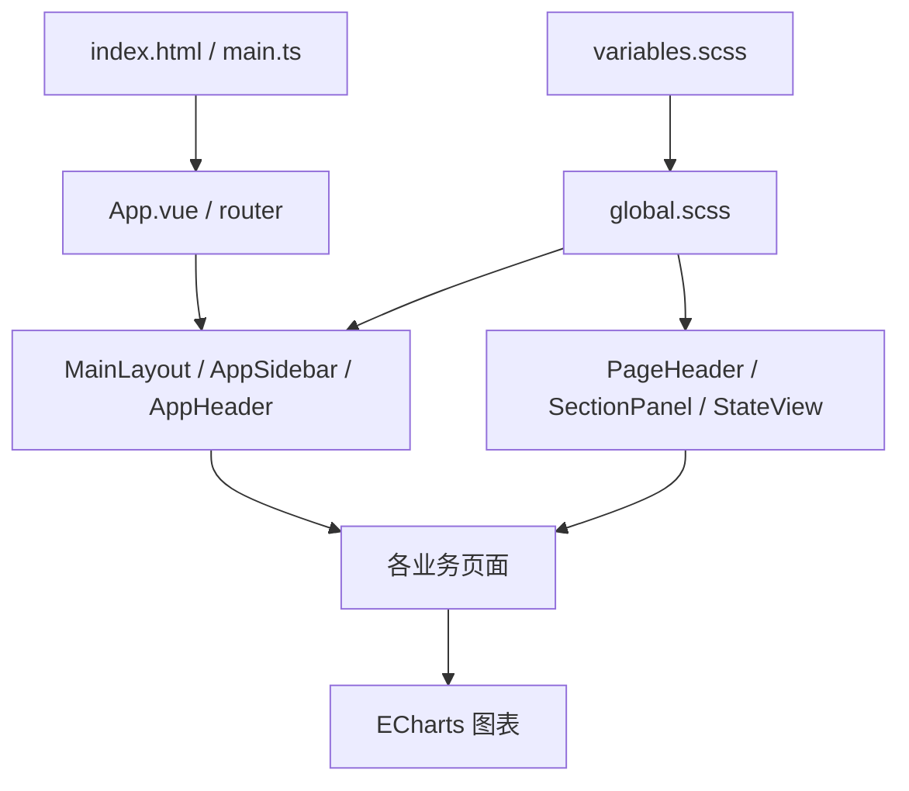

# 视觉方向与实现方案

> 状态：已批准，代码已实施
> 关联需求：product.md
> 日期：2026-10-12

## 1. 设计概念

“从技术能力到下一份工作”的求职工作台。视觉应安静、准确、有掌控感：白色工作面、冷灰背景、清晰的深蓝文字、少量蓝色操作与数据强调。最有记忆点的位置是首页的个人求职进程，其他区域服务内容。

### 配色 token

| 名称 | 色值 | 用途 |
|---|---|---|
| 雾蓝底色 | #F3F6FA | 页面背景 |
| 白色工作面 | #FFFFFF | 内容、输入、侧栏 |
| 深蓝墨色 | #192A44 | 标题、主内容、首页重点 |
| 行动蓝 | #315CD8 | 主要按钮、选中、焦点 |
| 石板灰 | #66758B | 次要文字；浅底上使用 |
| 提醒金 | #C18424 | 小面积待完成提示、图表辅助；文字使用更深变体 |

成功、警告、错误继续使用有语义的独立颜色。边线采用浅蓝灰；正文对比度目标 WCAG AA。强调颜色必须对应动作、选择或数据语义。

### 字体与尺度

- 中文以 `Microsoft YaHei UI` 为本机主字体，后备为 `PingFang SC`、`Microsoft YaHei` 和系统 sans-serif；不依赖在线字体。
- 可使用 Windows 的 `Bahnschrift` 呈现少量数值，并设置等宽数字；正文保持中文主字体。
- 标题 28–32px、区块标题 18–20px、正文 14–16px、辅助说明 12–13px；不把 9–11px 文字作为主要阅读内容。
- 文本左对齐。阅读正文尽量限制为约 60–75 个字符宽度，长文本自然换行。
- 间距按 4/8/12/16/24/32/48px 组织。输入和小控件约 6–8px 圆角，主要工作面约 12–16px；阴影只用于浮层或确有层次的内容。

## 2. 版式与页面处理

桌面侧栏约 224px；内容区最大宽度约 1360px，左右呼吸空间 24–40px。侧栏承担导航、历史对话与账户，顶部呈现当前页面上下文与必要操作。移动端转为抽屉，内容单列。

首页宽主区与窄辅助区约 8:4 分配，先展示个人准备进程与下一步，再展示行业信息。数据多时有轻重，空数据时仍然提供有效入口。

```text
┌────────────┬────────────────────────────────────────────────┐
│ 品牌       │ 当前页面                          页面操作     │
│ 工作导航   ├────────────────────────────┬───────────────────┤
│            │ 你的求职准备               │ 当前目标 / 下一步 │
│            │ 档案 → 画像 → 简历 → 成长  │ 真实状态与操作    │
│ 历史对话   ├────────────────────────────┴───────────────────┤
│            │ 技术岗位需求             技能与岗位关联       │
│            ├────────────────────────────────────────────────┤
│ 账户       │ 近期技术资讯与来源                             │
└────────────┴────────────────────────────────────────────────┘
```

进程顺序用于说明真实求职准备步骤，不凭空添加编号或声称完成。任务状态仅依据现有档案和记录推导。

| 页面 | 呈现方式 |
|---|---|
| 档案 | 分组编辑，明确保存动作与完成信息；保持真实字段与校验 |
| 岗位 | 紧凑列表与筛选工具栏；岗位标题、匹配依据、技能和行动逐级组织 |
| 就业画像 | 结论先行，图表为证据；减少图表周围重复说明 |
| 求职教练 | 阅读舒适的消息流，稳定输入区，资料草稿为辅助区域 |
| 简历 | 编辑工具与纸张预览分离；文档呈现使用专属排版 |
| 成长规划 | 学习阶段、当前任务与成果顺序；不伪造任务进度 |
| 登录等 | 聚焦表单与品牌，必要说明短而直接；维持原有校验和跳转 |
| 配套页 | 统一标题、筛选、列表、表单和状态；适配长文本与移动布局 |

## 3. 对照需求后的设计修订

放弃沿现有墨绿渐变横幅继续堆砌视觉的路线：求职系统需要首先回答行动和依据。首页的个人准备进程承担识别点；行业图表、资讯和状态不再争抢注意力。

不采用每个模块相同尺寸的卡片阵列。岗位采用列表，教练采用阅读流，简历采用文档，成长采用任务序列；组件统一但信息组织服从用途。删去仅为装饰的眉题、箭头和背景噪点，保留有实际导航含义的图标。

## 4. 实现边界与组件路径



- `frontend/src/styles/variables.scss`：集中基础配色、布局、文字和控件 token，并映射 Element Plus。
- `frontend/src/styles/global.scss`：保留各业务页面的既有样式契约，集中导入以下四个呈现模块，移除其旧重复定义。
- `styles/shell.scss`：全局基线、应用外壳、导航、共用面板、控件、焦点和 reduced-motion。
- `styles/job-list.scss`：岗位筛选、列表与详情。
- `styles/conversation.scss`：对话阅读区、消息、输入区和草稿。
- `styles/access.scss`：登录、注册与找回密码。
- `MainLayout.vue`：合并现有首页专用外壳样式，必要差异放在首页内容组件。
- `AppSidebar.vue` / `AppHeader.vue` / `BrandMark.vue`：统一品牌与导航密度，继续复用现有切换、会话和账户操作。
- `components/common`：以已有组件为基础统一页面标题、内容区和状态，只有明确复用需要时才抽取组件。
- `views/dashboard/DashboardView.vue` / `dashboard.scss`：保留现有 computed、请求、筛选与路由逻辑，调整模板与布局。
- 其他主要页面：优先改模板和 scoped 样式，保留绑定、事件与请求。
- 图表：统一标签字号、颜色、网格留白，保留数据和交互语义。

## 5. 数据、接口与安全边界

没有新增实体、接口、存储 schema 或业务算法。所有认证守卫、登录提交、角色切换、会话持久化、API 调用、SSE 解析与导出逻辑继续使用现有实现。不能用临时登录绕过来展示页面。重构不得把没有数据的功能展示为成功。

## 6. 依赖白名单与错误状态

仅使用 package.json 中现有 Vue、Vue Router、Pinia、Element Plus、图标、ECharts、Axios、SCSS、TypeScript、Vite。错误沿现有状态展示：具体说明、原有重试动作、保留已获得内容。空列表引导设置筛选或补充档案。

## 7. 最小验收方案

编码完成后先做一个组合的定向验收，不写仅重复样式实现的单元测试：运行现有 `npm run build`，并通过浏览器检查固定样本（登录、工作台、岗位、教练、简历）的桌面 1440px 与手机 390px 呈现。截图仅覆盖这些呈现边界，观察焦点、长文本、主要操作和横向溢出。

认证后的页面需要现有有效会话或用户提供的测试账户；若条件缺失，报告未验收边界，不声称浏览器通过。构建成功不等同于后端、AI、投递或导出服务验收。

验收按用户 AGENTS 的单一问题、最小范围、最接近结论的检查和停止条件声明启动，共用一个可自动截停的 40 分钟 wall-clock 时限。通过且无相反证据即停止；失败时只扩大到最近失败的最小边界。编码、构建业务执行本身与审查计时分开。

## 8. 审批记录

2026-10-12：用户回复“继续”，批准本方案并授权实施。


## 实施与验证记录

2026-10-12：呈现层代码已实施，修复浏览器实际发现的教练选中文字对比度及移动端侧栏阴影后构建再次通过。用户登录后已采集四个受保护页面桌面/手机样本，无横向页面溢出。岗位骨架及首页行业统计仍加载，简历只有无版本空态，因此保留这些未确认边界；本轮不声称完整端到端验收，详见 tasks.md 与 frontend/output/playwright/validation.md。
